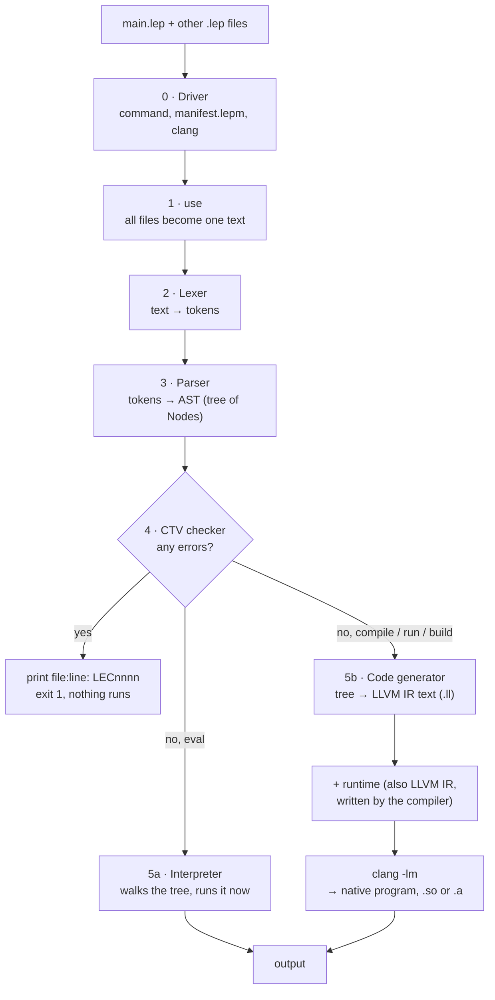
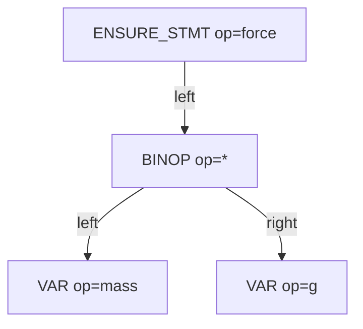
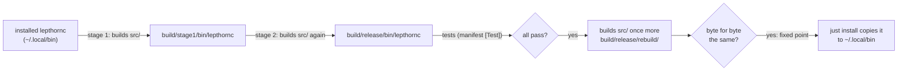

# Compiler Design

How `lepthornc` turns a `.lep` file into a running program: every
stage, what goes in, what comes out, and which file does the work.
[ARCHITECTURE.md](ARCHITECTURE.md) is the short version of this page.

Contents: [Big picture](#big-picture) ·
[0 Driver](#0-driver-the-front-desk) ·
[1 use](#1-use-many-files-become-one-text) ·
[2 Lexer](#2-lexer-text-becomes-tokens) ·
[3 Parser and AST](#3-parser-tokens-become-a-tree-ast) ·
[4 CTV](#4-ctv-the-checker) ·
[5a Interpreter](#5a-interpreter-run-the-tree-now) ·
[5b Code generator](#5b-code-generator-tree-becomes-llvm-ir) ·
[Values](#every-value-is-one-64-bit-word) ·
[Units](#how-a-unit-becomes-a-value) ·
[Self-hosting](#self-hosting-the-compiler-compiles-itself) ·
[Words](#words-used-on-this-page) ·
[What is missing](#what-is-missing-and-where-it-goes)

## Big picture

The compiler is one program written in Lepthorn. Every command walks
the same path: read the files, cut the text into tokens, build a tree,
check the tree. Then it either **runs the tree directly** (`eval`) or
**turns it into LLVM IR**, and Clang turns that into a real program
(`compile`, `run`, `build`). Both endings start from the same checked
tree, so they behave the same, and `lepthornc test` checks that they
do.



| Command | Stages it runs |
|---|---|
| `check` | 0 → 4. Stops after the checker. |
| `eval` | 0 → 4, then 5a. No program file is made. |
| `compile`, `run` | 0 → 4, then 5b and clang. `run` also starts the program. |
| `build`, `test` | The same, for every target or test named in `manifest.lepm`. |
| `resolve` | 0 → 1. Shows the one joined text, or what the manifest means. |

## 0. Driver: the front desk

Files: `src/driver/driver.lep`, `src/driver/manifest.lep`, `src/main.lep`

`main.lep` pulls in every part with `use` and calls `lepthornc_main()`.
The driver reads the command line and decides what to do. For project
commands it first walks up from the current folder until it finds a
`manifest.lepm`; that folder is the project root.

- **Manifest:** `manifest.lep` blanks out `(* *)` comments (keeping
  line numbers), reads each `[Section]` and `key = value` line, then
  checks everything: unknown keys, missing keys, absolute paths, and
  that each `[Target_<triple>]` matches its `triple`. Every error names
  the line.
- **Clang:** taken from `--cc`, then `LEPTHORN_CLANG`, then
  `LEPTHORN_CC`, then `clang` on `PATH`. No path is built in.
- **Host libc:** from `clang -print-target-triple` (glibc or musl).

Exit status: 0 success, 1 failure, 2 a wrong command or a wrong
manifest.

## 1. `use`: many files become one text

File: `src/driver/driver.lep` (`drv_source`, `drv_marker`)

Before anything is read as code, the driver follows every `use` line
and pastes that file's text in. `use "helper.lep"` names a file.
`use core::units` means `src/core/units/module.lep` if it exists, else
`src/core/units.lep`. A file already pasted is skipped, so two files
may use the same third file.

The result is one long text. To keep error messages right, the driver
writes a **marker comment** at the top of each file and after each
`use` line:

```text
(*@ src/core/units/registrar.lep 1 *)
... text of registrar.lep ...
(*@ src/core/units/module.lep 3 *)
```

Later, when an error is found at some character offset, `src_where`
looks back for the nearest marker and turns the offset into
`file:line`. The lexer skips markers like any comment.

**Why one text?** Functions can be called before they are written, and
two files can call each other. With one text the parser sees all
functions at once, so the order of files does not matter.

## 2. Lexer: text becomes tokens

File: `src/core/lang_syntax/data_types.lep` (`next_token`, `lex_all`)

The lexer reads the text one character at a time and cuts it into
**tokens**: the smallest pieces that mean something, like words in a
sentence. It skips spaces and comments. `(* *)` comments can be nested:
the lexer counts how deep it is, so commenting out code that has its
own comment works. An unclosed comment is `LEC1001`.

For the line `ensure mass = 25kg` it makes:

| Token kind | Value | Note |
|---|---|---|
| `ENSURE` | `ensure` | a keyword (`classify_keyword` decides) |
| `IDENT` | `mass` | a name |
| `OP` | `=` | operators: `+ - * / % ** == != < <= & \| ^ << >> ::` and the `+=` family |
| `NUMBER` | `25kg` | the number and its unit stay together; the parser splits them |
| `NEWLINE` | | ends a statement (there are no semicolons) |

Some tricks the lexer does so the parser stays simple:

- `done()` with nothing inside becomes one token, `DONE_EMPTY`, so
  "end of block" and `done(value)` ("return a value") never get mixed
  up.
- `ensure!` and `suppose!` become single block tokens.
- Inside an open `(` or `[` a newline is ignored, so a call or a list
  can go over several lines.
- The last token is `EOF` (end of file). A bad character gives
  `LEX_ERROR`.

All tokens go into one ring buffer. The parser reads it through a
`Cursor` (a position number), so it can look a few tokens ahead.

## 3. Parser: tokens become a tree (AST)

Files: `src/core/lang_syntax/parser.lep`, `src/core/ast/ast.lep`

The parser reads tokens and builds the **AST** (abstract syntax tree):
a tree that shows how the program is put together. It is a **recursive
descent** parser: there is one function per kind of thing
(`parse_statement`, `parse_when_tail`, `parse_make`, `parse_add`, ...),
and they call each other the same way the grammar nests.

### Operator order (precedence)

Each level calls the next stronger one first, so stronger operators sit
deeper in the tree and are done first. Weakest at the top:

```text
parse_or        or
parse_and       and
parse_not       not
parse_bitwise   &  |  ^  <<  >>      (weaker than comparisons, on purpose)
parse_compare   ==  !=  <  <=  >  >=
parse_add       +  -
parse_mul       *  /  %
parse_pow       **
parse_unary     ~
parse_primary   number, text, true/false, name, call, a.b, a[i], Shape(...), [..], ( ... )
```

So `a + b * c` becomes `a + (b * c)`, and `a & b == c` becomes
`a & (b == c)`, which the checker then rejects.

### The arena: how the tree is stored

Lepthorn has no pointers, so the tree is not made of linked objects.
Every node is a `Node` shape stored in one big list, the **arena**. A
node points to another node by its **position number** in that list.
`none_idx()` (999999) means "no node".

```text
shape Node
    kind        "BINOP", "NUM", "WHEN_STMT", ...
    num_value   the number of a NUM node (25)
    bool_value  true / false of a BOOL node
    text_value  the text of a TEXT node
    op          the operator, name or unit ("*", "mass", "kg")
    params      extra text (a field name, parameter list)
    left        first child  (position in the arena)
    right       second child
    sibling     the next statement in the same block
    alt         the otherwise branch
    arg2        one more child when needed
    pos         where in the source it was (for error messages)
done()
```

For `ensure force = mass * g` the parser makes:



Statements in a block are chained through `sibling`: the first
statement points to the second, and so on. A `when` keeps its
condition in `left`, its body in `right`, and the `otherwise` part in
`alt`.

Other things the parser does:

- A `NUMBER` token `25kg` is split into `num_value = 25` and
  `op = "kg"`.
- `make` functions go into a separate list, `funcs` (name, parameters,
  body). `shape` declarations go into `shapes`.
- `loop_hz(100)` is rewritten as `loop_hz 100 * 1Hz`, so later stages
  see only one form.
- `x += 1` is rewritten as `x = x + 1`. `ensure!` blocks become plain
  declarations.
- On a syntax error it makes a `PARSE_ERROR` node, moves one token
  forward and goes on, so it never loops forever. Any `PARSE_ERROR`
  stops the build with a `LEC2xxx` error.

Node kinds in use: `NUM BOOL TEXT VAR BINOP UNARY CALL FIELD_ACCESS
INDEX_ACCESS SHAPE_CONSTRUCT ARRAY_LITERAL ENSURE_STMT SUPPOSE_STMT
SHARED_ENSURE_STMT SHARED_SUPPOSE_STMT ASSIGN_STMT FIELD_ASSIGN_STMT
INDEX_ASSIGN_STMT SHOW_STMT WHEN_STMT CHOOSE_STMT CASE
REPEAT_FOREVER_STMT REPEAT_COUNT_STMT REPEAT_UNTIL_STMT STOP_STMT
NEXT_STMT RETURN_STMT EVERY_STMT LOOP_HZ_STMT WAIT_STMT DEADLINE_STMT
TIMEOUT_STMT PARALLEL_STMT TASK ATOMIC_STMT SYNC_STMT WATCH_STMT
INTERRUPT_STMT EXPR_STMT DECL_BLOCK_STMT`.

## 4. CTV: the checker

File: `src/core/ctv/ctv.lep` (CTV = Compile-Time Verifier)

The checker reads the whole tree **before anything runs**, in two
passes.

1. **Collect.** Walk the top-level code and every function body and
   write down every name that is declared, whether it is `ensure`
   (fixed) or `suppose` (can change), and which names are `shared`.
2. **Check.** Walk again. For every node, test the rules below. Each
   broken rule adds an error with the node's `pos`.

| Rule | Example that is rejected |
|---|---|
| Units must match (see below) | `2kg + 3m`, `1kg < 2m` |
| Every name must be declared | `show speed` with no `speed` |
| An `ensure` value cannot change | `ensure limit = 2m` then `limit = 3m` |
| A function must exist and get the right number of arguments | `p_control(1, 2)` when it takes 3 |
| `stop` / `next` only inside a loop | `stop` at the top level |
| A `shared suppose` change inside `parallel` needs `atomic` | `counter = counter + 1` in a task |
| `loop_hz` needs a frequency | `loop_hz 5kg`, `loop_hz 0Hz` |
| `choose` labels: one kind, no repeats | `case 1` and `case "b"` together |
| No true/false next to a bitwise operator | `a & b == c` |

Errors are printed like this, with the file and line found through the
`use` markers:

```text
r1.lep:2: LEC3003: cannot reassign 'limit' - declared with ensure (immutable)
    limit = 3m
```

**Units** are checked by a second file, `src/core/ctv/checker.lep`.
It follows units from the numbers written with a unit (`25kg`) through
variables (a variable keeps the unit of its first value), through
`*` and `/`, and through calls. Then `+`, `-`, `%` and `<` `>` `<=` `>=` must have the
same unit on both sides, and a new value for a variable must keep its
unit:

| Program | Checker error |
|---|---|
| `ensure d = 2kg + 3m` | `` `+` needs the same unit on both sides, got kg and m `` |
| `show 1kg < 2m` | `` `<` needs the same unit on both sides, got kg and m `` |
| `suppose speed = 2m / 1s` then `speed = 5kg` | `'speed' holds m/s, it cannot take a value in kg` |
| `make add(a, b)` ... `show add(2kg, 3m)` | ``in this call to 'add': `+` needs the same unit on both sides, got kg and m`` |

**Calls.** When a call gives some arguments with known units, the
checker checks the function's body again with each parameter set to
its argument's unit. An error found inside is shown at the call, where
the wrong units were given. The units of `done(value)` become the unit
of the call, so `ensure v = speed(10m, 2s)` makes `v` a speed. Each
function and set of argument units is checked once and remembered
(`done_calls`). A function that calls itself is not checked again
while it is being checked (`calling`).

Where a unit cannot be known before running (input, shape fields,
array items, collections, the parameters of a function no call gives
units to) nothing is reported, so a correct program is never rejected.
The run-time check then catches a real mismatch and stops the program
with `LER2001`.

### Errors

Every error, with its code, is in one place,
`src/core/errors/` (see [ERRORS.md](ERRORS.md)). The lexer, parser, checker and code
generator ask for an error by name (`error_line("unit_mismatch", [op,
a, b])`). The run-time code asks for the same messages when it is
written (`rt_error`), with each `{n}` turned into a printf format, so
the interpreter and a compiled program always print the same text.
`LEC` codes are found before the program runs, `LER` codes while it
runs.

## 5a. Interpreter: run the tree now

Files: `src/runtime/interpreter.lep`, `src/runtime/primitives.lep`

The interpreter (`lepthornc eval`) walks the checked tree and does what
each node says. Two main functions do the work:

- `eval_node` takes an **expression** node and returns its value. A
  `NUM` looks up its unit and makes a quantity; a `BINOP` computes both
  sides and combines them; a `CALL` runs a function.
- `exec_stmt` takes a **statement** node and does it: declare, assign,
  show, branch, loop.

**Signals.** Every statement returns a small `Sig` that says how it
ended: `NORMAL` (go on), `STOP` (leave the loop), `NEXT` (next round)
or `RETURN` (leave the function with a value). A loop looks at the
signal from its body to know what to do. This is how `done(value)` can
leave a function from deep inside nested `when` and `repeat` blocks.

**Variables.** Each function call gets a new, empty list of variables
(`env`) holding only its parameters. `shared` values live in a separate
list that every function can see.

**Places.** Before an operation that can fail, the interpreter tells
the runtime where the program is (`sys::at_place`), so the same report
prints the error in both modes. Each call of the program takes several
calls of the interpreter, so the interpreter raises its own limit
(`sys::recursion_limit`) and counts the program's calls itself.

**Same values as compiled programs.** The interpreter is itself a
compiled Lepthorn program. When the program being interpreted says
`a + b`, the interpreter does `a + b` with its own real values, so the
same runtime code does the work in both modes. Timing statements
(`loop_hz`, `every`, `wait`) use the language's own timing.

## 5b. Code generator: tree becomes LLVM IR

Files: `src/codegen/cg_core.lep`, `cg_expr.lep`, `cg_stmt.lep`,
`cg_program.lep`, `cg_rt_*.lep`

Instead of running the tree, the code generator writes text in **LLVM
IR**, a simple machine-like language. Clang then turns that text into
real machine code. Writing IR is much easier than writing machine code
for each processor, and LLVM does the optimizing.

- Each `make` function becomes an LLVM function `@lf.<name>`. Every
  argument and result is one `i64` (a 64-bit word).
- The top-level statements become `main` (in a library:
  `<name>_init`, and each function is exported as
  `<name>_<function>`).
- Each local variable gets one slot on the stack (`alloca`). Reading is
  `load`, writing is `store`.
- `when` and loops become labeled blocks and jumps (`br`).
- Arithmetic and printing are calls into the runtime: `@lep_qty`,
  `@lep_mul`, `@lep_div`, `@lep_show_arg`, ...
- The call depth is counted and stops at 10,000, so endless recursion
  gives a clear error. The program raises its own stack to 100 MB at
  the start, so 10,000 calls fit.
- Every place that can fail is a *spot* (`places.lep`): file, line,
  column. `@lep.place` holds the number of the spot; it is written just
  before a call that can fail. The fast way of `+ - * /` and the
  comparisons takes the number as its last value and writes it only
  when it fails, so it costs nothing.

This program:

```text
ensure mass = 25kg
ensure g = 9.81m / (1s * 1s)
show "force:" mass * g
```

becomes this `main` (from the real output of
`lepthornc compile --emit-llvm`; some long lines shortened with `...`):

```llvm
define i32 @main(i32 %argc, ptr %argv) {
entry:
  call void @lep_init(i32 %argc, ptr %argv)
  %v.mass = alloca i64                 ; a slot for mass
  store i64 10, ptr %v.mass            ; 10 = "no value yet"
  %v.g = alloca i64
  store i64 10, ptr %v.g
  br label %body
body:
  ; 25kg: value 25, dimension kg=1 (8 exponents)
  %t1 = call i64 @lep_qty(double 25.0, i32 1, i32 0, i32 0, i32 0, i32 0, i32 0, i32 0, i32 0)
  store i64 %t1, ptr %v.mass
  %t2 = call i64 @lep_qty(double 9.81..., i32 0, i32 1, i32 0, ...)   ; 9.81m
  %t3 = call i64 @lep_qty(double 1.0, i32 0, i32 0, i32 1, ...)       ; 1s
  %t4 = call i64 @lep_qty(double 1.0, i32 0, i32 0, i32 1, ...)       ; 1s
  %t5 = call i64 @lep_mul(i64 %t3, i64 %t4)                           ; 1s * 1s
  %t6 = call i64 @lep_div(i64 %t2, i64 %t5)                           ; 9.81m / s²
  store i64 %t6, ptr %v.g
  %t8 = ptrtoint ptr @.s7 to i64                                      ; "force:"
  %t9 = load i64, ptr %v.mass
  %t10 = load i64, ptr %v.g
  %t11 = call i64 @lep_mul(i64 %t9, i64 %t10)                         ; mass * g
  call void @lep_show_arg(i64 %t8, i64 1)
  call void @lep_show_arg(i64 %t11, i64 0)
  call void @lep_show_end()
  call void @lep_finish()
  ret i32 0
}
```

### The runtime

The functions like `@lep_mul` are the **runtime**: the code every
program needs (memory, numbers with units, text, arrays, shapes,
collections, files, printing, timing). It is also LLVM IR, written by
the `cg_rt_*.lep` files, and pasted at the end of every `.ll` file. It
calls only libc and libm. There is no C source anywhere.

Last step: the driver runs `clang -O2 -o program program.ll -lm` (no
`-O2` for debug builds). The generated IR always says
`source_filename = "lepthorn"`, so the output does not depend on the
folder it was built in.

## Every value is one 64-bit word

In compiled programs and in the interpreter, a value is always one
64-bit number. The code generator does not have to know a value's type
ahead of time; the runtime looks at the word when an operation needs to
know.

| Value | How it is stored in the word |
|---|---|
| Number with no unit (`23`) | its IEEE-754 double bits plus 2^49, inside the word itself |
| `false`, `true` | 6, 7 |
| "no value" (a function ended without `done(value)`) | 10 |
| Everything else | an address of an object on the heap; the object starts with its kind: Text, Number with a unit (value + 8 exponents), shape, array, RingBuffer, Queue, Stack, file handle, Vector, Matrix |

**Cost today:** every result with a unit is a new heap object, and
memory is never given back (no garbage collector, and no release yet).
Phase 1 item 11 and Phase 2A are about this.

## How a unit becomes a value

Files: `src/core/units/base_units.lep`, `registrar.lep`,
`general_units/si_units.lep`, `IEEE/`, `American/`

A **dimension** says what a quantity is made of: how many times each
of the 8 base units appears (`kg m s A K mol cd rad`).
`base_units.lep` is the only place that names them. Its `Dimension`
shape has one field per base unit: `mass`, `length`, `time`,
`current`, `temperature`, `amount`, `luminosity`, `angle`.

**Adding a unit is one line** in its group's file, with the dimension
written as text the way a physics book writes it:

```lepthorn
add_unit(list, "km", "m", 1000)
add_unit(list, "N", "kg m / s^2", 1)
add_unit(list, "Hz", "1 / s", 1)
add_unit(list, "psi", "kg / m s^2", 6894.757)
```

Words are base units, split by spaces; every word after `/` goes below
the line; `^2` or `^-1` is a power; `1` means "nothing". Only one `/`
is allowed, so `a / b * c` can never mean two things. The same
dimension can also be written `"kg / (m * s^2)"` (`*` and brackets
only separate words) or `"kg * m^-1 * s^-2"`, but the unit files use
the space style only, so they all read the same. A mistake in the text
stops the compiler with `LEC3104`-`LEC3107`.
`dimension_from_text` turns the text into a `Dimension`.

| Quantity | mass | length | time | Written |
|---|---|---|---|---|
| mass | 1 | 0 | 0 | `kg` |
| speed | 0 | 1 | −1 | `m/s` |
| acceleration | 0 | 1 | −2 | `m/s²` |
| force | 1 | 1 | −2 | `kg·m/s² (N)` |
| frequency | 0 | 0 | −1 | `s⁻¹ (Hz)` |

**The unit list.** `build_unit_table()` in `registrar.lep` makes one
list of all units. Each folder adds its group: `add_si_units`,
`add_ieee_units`, `add_american_units`. Each unit has a name (`km`), a
dimension (length) and a size in SI (1000, because 1 km = 1000 m). The
list grows by itself, so there is no limit. Every part of the compiler
(checker, interpreter, code generator, `take` input) reads this one
list.

**When the program meets `25km`:** the unit `km` is found in the list,
the value becomes 25 × 1000 = 25000, and the dimension is length. So
everything inside is in SI, and `1km + 5m` is simply 1000 + 5 = 1005 m.

**Arithmetic on dimensions:**

- `*` adds the exponents: m × m = m²; kg × m/s² = kg·m/s².
- `/` subtracts them: m ÷ s = m/s.
- `+` and `-` need the same dimension on both sides; otherwise it is a
  dimension mismatch.
- When printing, a known combination also shows its name: `(N)`,
  `(Pa)`, `(Hz)`, `(J)`, `(W)`.

## Self-hosting: the compiler compiles itself

The compiler is written in Lepthorn, so it needs a Lepthorn compiler to
be built. The installed `lepthornc` is used for that, in two stages,
and the result must rebuild itself exactly. Details are in
[BUILDING.md](BUILDING.md).



Why two stages: stage 1 is made by the *old* compiler, so it may still
carry old bugs. Stage 2 is made by a compiler built from the *new*
source, so it is the new compiler through and through. The **fixed
point** (stage 2 rebuilding itself into an identical file) shows the
new compiler reads its own source the same way every time.

**A catch:** if the new source uses something the old installed
compiler does not understand (a new manifest format, or a function with
an empty body before that was allowed), stage 1 fails. Then first
install a compiler that has the fix but does not use it yet, and use it
in the next round.

## Words used on this page

| Word | Meaning |
|---|---|
| Token | One meaningful piece of text: a keyword, name, number, operator or newline. |
| Lexer | The part that cuts text into tokens. |
| Parser | The part that puts tokens together into a tree, following the grammar. |
| Grammar | The rules for which token orders are allowed. |
| AST | Abstract syntax tree: the program as a tree of nodes, without spaces and comments. |
| Arena | One list holding all nodes; nodes point to each other by position number. |
| Recursive descent | A parser made of functions that call each other in the same nesting as the grammar. |
| Precedence | Which operator is done first: `*` before `+`. |
| CTV / checker | The part that finds mistakes before the program runs (static checking). |
| Static / dynamic | Static: found before running. Dynamic: found while running. |
| Interpreter | Runs the tree directly, step by step. |
| LLVM IR | A simple, machine-like text language. Clang turns it into machine code for the real processor. |
| Runtime | Helper code inside every program: memory, units, text, printing, timing. |
| Linking | Joining the program's code with libraries (libc, libm) into one file. |
| Dimension | What a quantity is made of, as 8 exponents of base units. |
| Fixed point | A compiler that, built from its own source, gives back the same file. |

## What is missing, and where it goes

| Missing today | Stage it changes | Phase |
|---|---|---|
| Units of shape fields, array items and input known before running | 4 CTV: `checker.lep` | 1 |
| No unit data at run time when it is known | 5b code generator: plain doubles after the check | 1 |
| Memory is never given back | runtime allocator, regions | 2A |
| `parallel` on real threads; measured loop timing | runtime timing and threads | 2C |
| `error`, `on error` | 2 lexer, 3 parser, 4 CTV, 5a, 5b | 0 / 2C |
| Calling C functions (FFI) | 3 parser (`extern`), 5b code generator | 3 |
| ROS 2 | a separate `ros2` library, not the compiler | 4B–10 |
